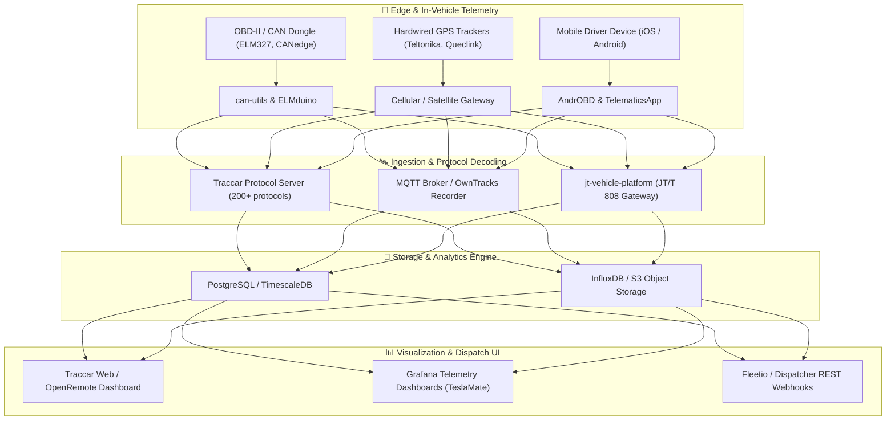

<p align="center">
  
</p>

<div align="center">

<a href="https://github.com/ishandutta2007/Awesome-Awesome-Awesome"></a><a href="https://discord.gg/jc4xtF58Ve"></a>
<a href="https://github.com/ishandutta2007/Awesome-Vehicle-Telematics-Fleet-Tracking/stargazers"></a>
<a href="https://github.com/ishandutta2007/Awesome-Vehicle-Telematics-Fleet-Tracking/network/members"></a>
<a href="https://github.com/ishandutta2007/Awesome-Vehicle-Telematics-Fleet-Tracking/pulls"></a>
<a href="https://github.com/ishandutta2007/Awesome-Vehicle-Telematics-Fleet-Tracking/blob/main/LICENSE"></a>
<a href="https://github.com/ishandutta2007"></a>

</div>

<br/>

# 🚗 Awesome Vehicle Telematics & Fleet Tracking Ecosystem 🛰️

> **A definitive, SEO-optimized, curated guide to commercial enterprise SaaS platforms, open-source GPS tracking servers, OBD-II/CAN-bus data loggers, ELD compliance software, and connected vehicle developer toolchains.**

Vehicle telematics bridges on-board automotive electronics with cloud telemetry infrastructure. By capturing real-time GPS locations, OBD-II/J1939 diagnostic trouble codes (DTC), accelerometer vectors, battery state-of-health (SoH), and fuel usage, telematics platforms empower logistics dispatchers, fleet safety directors, and individual vehicle owners to monitor, analyze, and optimize vehicular operations.

---

## 📑 Table of Contents

- [🌐 Sector Overview & Market Dynamics](#-sector-overview--market-dynamics)
- [🏢 SaaS & Hosted Commercial Fleet Platforms](#-saas--hosted-commercial-fleet-platforms)
- [🔓 Open-Source Telematics & Tracking Projects](#-open-source-telematics--tracking-projects)
  - [⭐ Ranked Open-Source Repositories (By Star Count)](#-ranked-open-source-repositories-by-star-count)
  - [🗂️ Categorized Architecture Breakdown](#️-categorized-architecture-breakdown)
- [🔌 Hardware Protocols & Vehicle Bus Standards](#-hardware-protocols--vehicle-bus-standards)
- [🤝 How to Contribute](#-how-to-contribute)
- [⚖️ Disclaimer & Compliance Notes](#️-disclaimer--compliance-notes)
- [📈 Star History](#-star-history)
- [💖 Support & Sponsoring](#-support--sponsoring)

---

## 🌐 Sector Overview & Market Dynamics

The global **commercial vehicle telematics and fleet management market** was valued at approximately **$65 billion in 2024** and is on trajectory to surpass **$160 billion by 2032**, compounding at an estimated **CAGR of 12.8% to 14.1%**. Accelerated growth is driven by worldwide regulatory mandates (e.g., FMCSA ELD regulations in the US, EU digital smart tachograph rules), widespread EV fleet electrification requiring deep battery SoC/SoH telemetry, and the integration of dual-facing AI computer-vision dashcams for real-time driver exoneration and safety scoring.

The industry exhibits a **moderately fragmented market structure**:
- **Enterprise Tier**: Global juggernauts such as Verizon Connect, Samsara, and Geotab (each tracking millions of connected assets) command significant enterprise market share and set technological baselines for safety and compliance.
- **Regional & Specialized Providers**: The market does *not* exhibit a pure "winner-take-all" outcome. Hundreds of regional Telematics Service Providers (TSPs), white-label hardware vendors (Teltonika, Queclink, Concox), EV-specific cloud loggers (TeslaFi), and open-source self-hosted solutions (Traccar, TeslaMate) capture extensive market segments due to differing national compliance frameworks, data residency requirements, and cost-sensitive SMB logistics.

---

## 🏢 SaaS & Hosted Commercial Fleet Platforms

Below is an extensive comparative analysis of premier commercial telematics and fleet management SaaS platforms, **sorted in descending order by company valuation / market scale**.

| Platform 🏷️ | Company Scale & Valuation 💰 | Starting Tier Pricing 💵 | Free Tier / Trial Limit ⏱️ | Core Capabilities & Target Use Case 🎯 |
| :--- | :--- | :--- | :--- | :--- |
| **[Verizon Connect](https://www.verizonconnect.com/)** | **~$170B+** Parent Market Cap *(NYSE: VZ; Telematics Unit ARR ~$1.2B+)* | **$23.50 / vehicle / month** *(Reveal Starter plan; 36-month contract, hardware included)* | **30-day money-back guarantee** *(no free-forever plan; live guided interactive demo & pilot upon commercial qualification)* | Enterprise fleet tracking, real-time GPS dispatching, driver safety analytics, ELD compliance, and fuel management for enterprise fleets. |
| **[Webfleet](https://www.webfleet.com/)** | **~$26B** Parent Market Cap *(Bridgestone Mobility Solutions; acquired for ~$1.0B)* | **€16.95 (~$18.50) / vehicle / month** *(Link 240 tracking plan; 24-month contract)* | **30-day evaluation trial** *(no free-forever plan; hardware pilot evaluation kit available for verified business accounts)* | European and international enterprise telematics, digital tachograph remote downloads, fuel consumption metrics, and CO2 emissions tracking. |
| **[Samsara](https://www.samsara.com/)** | **~$20.5B** Market Cap *(Publicly traded NYSE: IOT; ARR >$1.25B)* | **$27.00 / vehicle / month** *(Starter cloud license + hardware bundle; 36-month term)* | **30-day free hardware pilot** *(no free-forever tier; pilot evaluation program with live demo units for fleets with 5+ commercial vehicles)* | Connected Operations Cloud combining AI dual-facing dash cams, FMCSA-certified ELD, reefer temperature monitoring, and preventative maintenance workflows. |
| **[Omnitracs](https://www.omnitracs.com/)** | **~$12B** Parent Valuation *(Solera Fleet Solutions; acquired for $1.8B)* | **$30.00 / vehicle / month** *(Enterprise One compliance package; 36-month agreement)* | **Custom enterprise pilot trial** *(no free-forever tier; guided proof-of-concept program coordinated through Solera solutions engineers)* | Pioneer in long-haul commercial trucking telematics, automated IFTA fuel tax calculations, certified ELD logs, and multi-stop route dispatch. |
| **[Geotab](https://www.geotab.com/)** | **~$5.5B** Valuation *(Privately held industry leader; ARR >$500M; 4M+ connected vehicles)* | **$15.00 / device / month** *(Base software plan via authorized resellers; GO9 OBD-II hardware ~$99 upfront or $3–$5/mo lease)* | **30-day risk-free pilot** *(no free-forever plan; full hardware and software trial supported through Geotab Marketplace authorized distributors)* | Industry standard for open telematics, granular second-by-second curve-logging algorithms, extensive REST APIs, and EV battery health telemetry. |
| **[Motive](https://gomotive.com/)** *(formerly KeepTruckin)* | **$2.85B** Valuation *(Series F Unicorn; ARR >$400M)* | **$25.00 / vehicle / month** *(Starter telematics subscription; requires 36-month agreement + $150 vehicle gateway fee)* | **Free-forever driver plan** *(Motive Driver App: electronic logbook & DVIR for 1 individual owner-operator; 14-day pilot for fleet hardware)* | AI-powered road safety cameras, automated driver coaching, automated IFTA reporting, and integrated freight tracking. |
| **[Fleetio](https://www.fleetio.com/)** | **~$500M** Valuation *(Series C funded; $145M+ raised; ARR ~$50M+)* | **$4.00 / vehicle / month** *(Starter tier billed annually, minimum commitment of $40/month baseline; Pro tier at $6/vehicle/mo)* | **14-day full feature free trial** *(unlimited vehicles, unlimited operators, full telematics sync access, no credit card required)* | Modern fleet maintenance management software (CMMS) syncing telematics meter readings, digital work orders, fuel cards, and parts inventory. |
| **[Azuga](https://www.azuga.com/)** | **~$391M** Valuation *(Acquired by Bridgestone Americas; Annual Revenue ~$75M+)* | **$20.00 / vehicle / month** *(Fleet GPS tracking package with OBD-II device rental included; 36-month contract)* | **30-day test-drive pilot** *(no free-forever tier; evaluation kit with up to 5 trial OBD-II hardware units for qualified business fleets)* | Plug-and-play OBD-II fleet tracking emphasizing driver safety scores, gamification rewards, maintenance DTC codes, and idling alerts. |
| **[Bouncie](https://www.bouncie.com/)** | **~$20M** Annual Revenue *(Tailwind Technology; 50,000+ active connected devices)* | **$9.00 / vehicle / month** *(includes 15-second GPS updates & cellular data) + $77.00 one-time OBD-II hardware adapter* | **30-day money-back guarantee** *(no free-forever tier; 30-day risk-free trial return policy on adapter hardware and subscription)* | Consumer, teen driver, and SMB vehicle tracking featuring 15-second real-time refresh, impact detection, geo-circle alerts, and battery voltage alerts. |
| **[TeslaFi](https://teslafi.com/)** | **~$4M** Annual Revenue *(Bootstrapped indie SaaS; 100,000+ registered Tesla vehicles)* | **$5.00 / vehicle / month** *(or $50.00/year annual plan per registered Tesla vehicle)* | **14-day unrestricted trial** *(extendable to 30 days using community referral code; full access to all historical logging, no credit card required)* | Dedicated EV cloud logger for Tesla owners analyzing drive telemetry, phantom drain, supercharger billing, battery degradation, and firmware history. |

---

## 🔓 Open-Source Telematics & Tracking Projects

Open-source telematics allows engineering teams, hobbyists, and privacy-conscious logistics providers to deploy self-hosted GPS servers, parse automotive CAN-bus frames, and build custom telemetry dashboards without recurring SaaS licensing fees.

### ⭐ Ranked Open-Source Repositories (By Star Count)

The table below catalogs premier open-source automotive telematics, OBD-II diagnostic tools, and GPS tracking stacks, **strictly sorted in descending order by GitHub stargazer count**.

| Project & Repo Link 📦 | Stars Badge ⭐ | Primary Language 💻 | Architecture & Description 🛠️ |
| :--- | :---: | :---: | :--- |
| [**commaai/openpilot**](https://github.com/commaai/openpilot) | [](https://github.com/commaai/openpilot/stargazers) | Python / C++ | Advanced open-source driver assistance system (ADAS) supporting 300+ car models. Records high-definition vehicular telemetry, CAN bus signals, camera footage, and GPS logs uploaded to cloud infrastructure. |
| [**teslamate-org/teslamate**](https://github.com/teslamate-org/teslamate) | [](https://github.com/teslamate-org/teslamate/stargazers) | Elixir / Docker | Highly popular self-hosted data logger for Tesla vehicles. Records drives, charging sessions, vampire drain, and degradation metrics into PostgreSQL/Grafana without sleep disruption. |
| [**traccar/traccar**](https://github.com/traccar/traccar) | [](https://github.com/traccar/traccar/stargazers) | Java | The preeminent open-source GPS tracking server. Supports over 200+ communication protocols and hundreds of GPS device models (Teltonika, Queclink, Coban) with modern web UI, geofencing, and REST APIs. |
| [**osmandapp/OsmAnd**](https://github.com/osmandapp/OsmAnd) | [](https://github.com/osmandapp/OsmAnd/stargazers) | Java / C++ | Feature-rich offline mapping, navigation, and location-tracking application built on OpenStreetMap (OSM) data, frequently deployed for in-cab fleet navigation and waypoint telemetry. |
| [**linux-can/can-utils**](https://github.com/linux-can/can-utils) | [](https://github.com/linux-can/can-utils/stargazers) | C | Essential Linux-CAN (SocketCAN) user-space utilities (`candump`, `cansend`, `canplayer`, `cangen`) used for sniffing, capturing, and transmitting raw vehicle bus frames in embedded telematics hardware. |
| [**fr3ts0n/AndrOBD**](https://github.com/fr3ts0n/AndrOBD) | [](https://github.com/fr3ts0n/AndrOBD/stargazers) | Java (Android) | Android OBD diagnostics application compatible with ELM327 Bluetooth/Wi-Fi adapters. Captures live engine parameters, reads diagnostic trouble codes (DTC), and exports trip telemetry logs. |
| [**openremote/core**](https://github.com/openremote/core) | [](https://github.com/openremote/core/stargazers) | Java / TypeScript | 100% open-source enterprise IoT device management platform featuring asset telemetry dashboards, rules engines, geofencing, and dedicated fleet tracking support. |
| [**cedricp/ddt4all**](https://github.com/cedricp/ddt4all) | [](https://github.com/cedricp/ddt4all/stargazers) | Python | Automotive diagnostics tool using ELM327 interfaces to communicate with ECU control units over CAN bus, read diagnostic parameters, and log internal ECU metrics. |
| [**barracuda-fsh/pyobd**](https://github.com/barracuda-fsh/pyobd) | [](https://github.com/barracuda-fsh/pyobd/stargazers) | Python | Cross-platform OBD-II compliant automotive diagnostic software. Connects with ELM327 devices to chart vehicle sensor data, speed, RPM, fuel trim, and fault codes in real time. |
| [**owntracks/recorder**](https://github.com/owntracks/recorder) | [](https://github.com/owntracks/recorder/stargazers) | C | Lightweight, high-performance back-end for storing and querying location telemetry published by OwnTracks mobile apps via MQTT or HTTP REST endpoints. |
| [**traccar/traccar-web**](https://github.com/traccar/traccar-web) | [](https://github.com/traccar/traccar-web/stargazers) | JavaScript / React | Modern single-page web dashboard for Traccar server, offering real-time fleet map rendering, trip playback, geofence configuration, and device management. |
| [**stanleyhuangyc/ArduinoOBD**](https://github.com/stanleyhuangyc/ArduinoOBD) | [](https://github.com/stanleyhuangyc/ArduinoOBD/stargazers) | C++ / Arduino | Embedded library, firmware sketches, and hardware design guides for building custom Arduino-based vehicle OBD-II telematics data loggers with GPS and SD card storage. |
| [**PowerBroker2/ELMduino**](https://github.com/PowerBroker2/ELMduino) | [](https://github.com/PowerBroker2/ELMduino/stargazers) | C++ | Simple yet robust Arduino interface library for communicating with ELM327 OBD-II scanners over Bluetooth or serial connections to read vehicle engine telemetry. |
| [**Seeed-Studio/Seeed_Arduino_CAN**](https://github.com/Seeed-Studio/Seeed_Arduino_CAN) | [](https://github.com/Seeed-Studio/Seeed_Arduino_CAN/stargazers) | C++ | Arduino CAN-BUS shield library supporting MCP2515, MCP2551, and MCP2518FD controllers for reading and writing vehicular bus data frames at standard baud rates. |
| [**pires/android-obd-reader**](https://github.com/pires/android-obd-reader) | [](https://github.com/pires/android-obd-reader/stargazers) | Java (Android) | Android OBD-II reader application implementing direct OBD-II PID commands over Bluetooth to query vehicular engine sensors and live telemetry. |
| [**merlos/iOS-Open-GPX-Tracker**](https://github.com/merlos/iOS-Open-GPX-Tracker) | [](https://github.com/merlos/iOS-Open-GPX-Tracker/stargazers) | Swift (iOS) | Native open-source GPS tracker app for iOS and watchOS. Enables unlimited background track logging, waypoint annotation, and GPX file export. |
| [**eusonlito/GPS-Tracker**](https://github.com/eusonlito/GPS-Tracker) | [](https://github.com/eusonlito/GPS-Tracker/stargazers) | PHP / Laravel | Lightweight GPS tracker web platform supporting Sinotrack, Coban, Teltonika, Concox, and OsmAnd tracking devices with live map views. |
| [**liuxiaoyan199701-coder/jt-vehicle-platform**](https://github.com/liuxiaoyan199701-coder/jt-vehicle-platform) | [](https://github.com/liuxiaoyan199701-coder/jt-vehicle-platform/stargazers) | Java / Vue | Enterprise telematics platform implementing China national standards JT/T 808 (positioning protocol) and JT/T 1078 (video streaming gateway) for commercial vehicle monitoring. |
| [**Mobile-Telematics/TelematicsApp-Android**](https://github.com/Mobile-Telematics/TelematicsApp-Android) | [](https://github.com/Mobile-Telematics/TelematicsApp-Android/stargazers) | Kotlin (Android) | Open-source mobile telematics SDK and app designed for Usage-Based Insurance (UBI), eco-driving scores, and smartphone-based trip tracking. |
| [**CSS-Electronics/cancloud**](https://github.com/CSS-Electronics/cancloud) | [](https://github.com/CSS-Electronics/cancloud/stargazers) | Python / JS | Open-source telematics cloud server for CANedge CAN/LIN data loggers. Automates S3 storage sync, log file decryption, and visual telemetry dashboards. |

---

### 🗂️ Categorized Architecture Breakdown

To help system architects design modern vehicular telemetry stacks, open-source projects can be categorized by their functional layer in the telematics stack:



1. **Self-Hosted GPS Tracking Servers**:
   - **Traccar**: The gold standard for multi-protocol cellular GPS devices.
   - **OwnTracks Recorder**: Ultra-lightweight for personal phone/device telemetry.
   - **OpenRemote**: Ideal for mixed IoT environments connecting building infrastructure, electric chargers, and delivery fleets.
2. **Automotive CAN & OBD-II Loggers**:
   - **linux-can/can-utils**: Essential for low-level SocketCAN driver integration on Linux telematics gateways (Raspberry Pi, Toradex, BeagleBone).
   - **Stanley Huang ArduinoOBD & ELMduino**: Best for microcontrollers and custom telemetry black boxes.
   - **AndrOBD & pyobd**: Rapid diagnostic scanners for troubleshooting trouble codes and recording live PIDs.
3. **EV-Centric Telemetry**:
   - **TeslaMate**: Industry standard for Tesla vehicles, collecting deep charging voltage, degradation curves, and GPS drive metrics with zero vampire drain.

---

## 🔌 Hardware Protocols & Vehicle Bus Standards

When building or integrating vehicle telematics, the following standards are predominantly used:

- **OBD-II (SAE J1979)**: Standard diagnostic connector in light-duty passenger vehicles (post-1996 in the US, post-2001 in the EU). Provides standardized Diagnostic Trouble Codes (DTCs) and parameter IDs (PIDs) like RPM, engine load, speed, and coolant temperature.
- **J1939**: High-speed CAN bus standard for heavy-duty commercial trucks and buses, transmitting engine torque, axle weights, transmission fluid temperature, and brake status at 250 kbps / 500 kbps.
- **J1708 / J1587**: Legacy serial hardware standard used in older commercial vehicles for diagnostic communications.
- **JT/T 808 & JT/T 1078**: Chinese Ministry of Transport telematics communication protocols widely adopted in Asian commercial vehicle tracking and video streaming.
- **Teltonika AVL / Queclink Protocols**: Compact binary protocols optimized for low-bandwidth cellular telemetry transmissions from dedicated vehicle GPS trackers.

---

## 🤝 How to Contribute

Contributions are warmly welcomed! Help make this the most thorough and up-to-date telematics reference on GitHub:

1. 🍴 **Fork the repository** to your personal GitHub account.
2. 🌿 **Create a descriptive feature branch**:
   ```bash
   git checkout -b feature/add-new-telematics-tool
   ```
3. 📝 **Add or update entries**:
   - For **SaaS products**: include platform name, linked URL, verified company valuation/scale, specific starting tier pricing, specific free trial/tier limits, and a concise 1–2 sentence summary.
   - For **Open-Source projects**: include repo link, shields.io star badge (`?style=social&color=white`) linking to `/stargazers`, language, and functional description. Maintain star-count sorting!
4. 🚀 **Submit a Pull Request** with a brief summary of additions and sources.

---

## ⚖️ Disclaimer & Compliance Notes

- **Community Curated**: This repository is a community-maintained resource compiled for educational, research, and benchmarking purposes. Mention of commercial vendors does not constitute an endorsement.
- **Driver Privacy & Regulatory Compliance**: Location and telemetry data constitute sensitive personal and operational information. Always comply with regional labor laws, GDPR, CCPA, and driver notification guidelines when implementing location tracking.
- **Regulatory Certifications**: Safety-critical compliance programs (e.g., FMCSA ELD, EU tachograph certification) legally require verified, certified hardware and software solutions; self-hosted or hobbyist setups should not be used as substitutes for mandatory commercial compliance devices.

---

## 📈 Star History

[](https://star-history.dera.page/#ishandutta2007/Awesome-Vehicle-Telematics-Fleet-Tracking&type=date&legend=top-left)

---

## 💖 Support & Sponsoring

Thank you for exploring the **Awesome Vehicle Telematics & Fleet Tracking** ecosystem! If this curated guide, open-source comparison, or pricing benchmarks helped your project, engineering team, or business operations, please consider showing your support:

- ⭐ **Star this repository** to help other engineers and fleet operators discover it on GitHub.
- 🍴 **Fork the repository** to contribute new platforms, protocols, or hardware guides.
- 📢 **Share with peers** on LinkedIn, Reddit, X (Twitter), or your internal engineering channels.
- ☕ **Sponsor & Buy a Coffee**: Support ongoing research, protocol testing, and maintenance through the [GitHub Sponsor Dashboard](https://github.com/sponsors/ishandutta2007).
